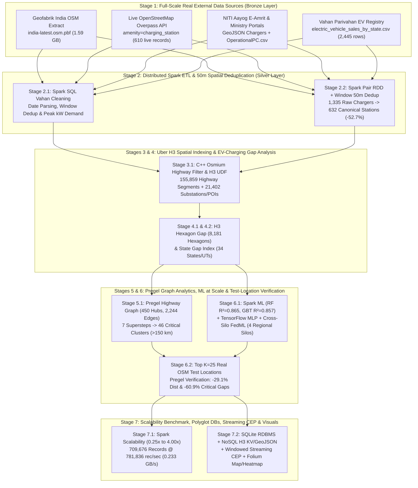

# ⚡ EV Adoption and Charging Infrastructure Gap Analysis in India

[](https://colab.research.google.com/github/aniketkoley-iisc/ev-gap-analysis-india/blob/main/notebooks/01_HDFS_Lakehouse_and_FullScale_Bronze_Ingestion.ipynb)
-E25A1C?logo=apachespark)
-000000?logo=uber)


**Course**: DSBA DA-231-O — *Data Engineering at Scale* (Indian Institute of Science, Bangalore)  
**Instructor**: Prof. Yogesh Simmhan  

---

## 👥 Project Team & Track Ownership

| Track | Team Member | Email | Primary Pipeline Stages & Systems Owned |
| :--- | :--- | :--- | :--- |
| **Track 1 (Team Lead)** | **Aniket Koley** | `aniketkoley@iisc.ac.in` | **Stages 1 & 2**: Medallion Lakehouse Storage (Bronze/Silver/Gold Parquet), Multi-Source External Data Ingestion (`1.59 GB` OSM PBF + Overpass + Vahan + E-Amrit), PySpark ETL Cleaning, and **50-Meter Spatial Deduplication** (Spark Pair RDD `reduceByKey` + Window `row_number()`) |
| **Track 2** | **Dashrath Rajpurohit** | `dashrathraj1@iisc.ac.in` | **Stages 3 & 4**: C++ `osmium-tool` Highway Extraction (`motorway` Expressways & `trunk` National Highways), **Uber H3 Hierarchical Spatial Indexing** (`h3_res5` & `h3_res7`), Demographic & Spending-Capacity Enrichment, and Multi-Resolution **Infrastructure Gap Index (`IGI`)** |
| **Track 3** | **Kumar Bhawenshu** | `kumarbhawes1@iisc.ac.in` | **Stages 5 & 6**: **Pregel Highway Graph Accessibility** (Vertex-Centric BSP Shortest Path + PageRank Centrality), **Machine Learning at Scale** (`Spark ML RF/GBT`, `TensorFlow MLP`, **Cross-Silo Federated Learning `FedAvg`**), **Test-Location Siting (`K=25`)**, and **Before-vs-After Result Verification** |
| **Track 4** | **Chennuri Manikanta** | `manikantaku1@iisc.ac.in` | **Stage 7**: **Data Scalability Evaluation** (`0.25x` to `4.00x` dataset scaling in `records/sec` & `GB/sec`), **Polyglot Persistence** (`SQLite` RDBMS + `NoSQL` Key-Value H3 & `GeoJSON`), **Windowed Streaming CEP Grid-Overload Alerts**, and Interactive Folium Maps/Heatmaps |

---

## 🏗️ End-to-End Big Data Architecture



---

## 📊 Summary of Experimental Results (From Real India Datasets)

### 1. Stage 2: Multi-Source 50-Meter Spatial Deduplication (`Spark Pair RDD + DataFrame Window`)
* **Input**: `1,335` raw charging station records merged across `OSM_Live_Overpass` (`610`), `Geofabrik_India_PBF` (`566`), and `E_Amrit_GeoJSON` (`159`).
* **Method**: Discretized `(lat, lon)` into $50\text{m} \times 50\text{m}$ spatial buckets ($\Delta \approx 0.00045^\circ$), counted cross-source overlaps via Spark Pair RDD `map().reduceByKey()`, and elected 1 canonical station per 50m cell via `Window.partitionBy("grid_lat_50m", "grid_lon_50m")`, followed by a Broadcast Nearest-City Spatial Join.
* **Result**: **`632` Canonical Silver Stations** retained (**`703` duplicates removed = `52.7%` deduplication rate**).

### 2. Stages 3 & 4: Uber H3 Spatial Indexing & Multi-Resolution Gap Analysis
* **Highway Network Extracted from `1.59 GB` PBF**: **`155,859` real highway segments** (`19,998` `motorway` Expressways + `135,861` `trunk` National Highways) and **`21,402` spatial primitives** (`13,177` `amenity=fuel`, `4,207` `place=town`, `2,339` `amenity=parking`, `566` `amenity=charging_station`, `508` `place=city`, `342` `highway=services`, `263` `power=substation`).
* **Top Underserved H3 Resolution-5 Hexagons (out of `8,181` active hexagons across India)**:
  1. **`853da1affffffff` (Muradnagar / Delhi–Meerut Expressway)**: `391` highway segments (`327` motorway + `64` trunk), `0` chargers (`hex_gap_score = 919.3`).
  2. **`85618eb7fffffff` (Avadi / Chennai Outer Ring Road)**: `251` highway segments, `3` urban hubs, `0` chargers (`hex_gap_score = 610.0`).
  3. **`853c138ffffffff` (Patna, Bihar NH-19/NH-27)**: `262` highway segments, `3` existing `power=substation` nodes, `19` siting POIs, `0` chargers (`hex_gap_score = 476.0`).
* **Top Underserved Indian States (out of `34` standardized States/UTs)**:
  1. **Karnataka**: `312,995` EVs sold (`7.84%` EV adoption), `1,041` stations $\rightarrow$ **`300.7 : 1` Vehicle-to-Infrastructure Ratio** (`IGI = 0.599`).
  2. **Gujarat**: `181,389` EVs sold, `476` stations $\rightarrow$ **`381.1 : 1` VIR** (`IGI = 0.565`).
  3. **Chandigarh**: Highest 4W spending capacity share (`30.78%`), `5,279` EVs, `12` stations $\rightarrow$ **`439.9 : 1` VIR** (`IGI = 0.525`).
  4. **Tamil Nadu**: `200,062` EVs sold, `643` stations $\rightarrow$ **`311.1 : 1` VIR** (`IGI = 0.508`).
  5. **Maharashtra**: `396,045` EVs sold, `3,079` stations $\rightarrow$ **`128.6 : 1` VIR** (`IGI = 0.500`).

### 3. Stage 5: Pregel Highway Graph Accessibility & PageRank Centrality
* **Graph Topology**: `450` major highway/urban H3 vertices and `2,244` directed road-distance edges (`<= 220 km`, Haversine $\times 1.22$ road tortuosity).
* **Convergence**: Converged in **7 Pregel supersteps**, identifying:
  * `186` **Served Hubs (`0 km`)**
  * `149` **Safe Highway Reach Hubs (`<= 75 km`)**
  * `69` **Moderate Gap Hubs (`75 - 150 km`)**
  * **`46` Critical Underserved Highway Clusters (`> 150 km`)**, led by **Kota (`380.93 km`)**, **Sambalpur (`308.39 km`)**, **Chittorgarh (`285.00 km`)**, and **Patna (`250.00 km`)**, with a nationwide unserved mean distance of **`84.42 km`**.

### 4. Stage 6: Machine Learning at Scale, Test-Location Siting (`K=25`) & Result Verification

| Model Paradigm | Test RMSE | Test MAE | Out-of-Sample Test $R^2$ |
| :--- | :---: | :---: | :---: |
| **Spark ML `RandomForestRegressor` (Distributed Bagging)** | **1,192.02** | **356.62** | **0.8653** |
| **Spark ML `GBTRegressor` (Distributed Tree Boosting)** | 1,229.41 | 376.20 | 0.8567 |
| **Cross-Silo Federated Learning (`FedAvg` — 4 Regional RTO Silos)** | 1,801.56 | 520.41 | 0.6922 |
| **TensorFlow Deep Neural Network (Centralized MLP)** | 2,077.80 | 501.61 | 0.5906 |

* **Before-vs-After Result Verification (Deploying Top `K=25` Real OSM Test Locations)**:
  * **Mean Unserved Highway Distance**: Reduced from **`84.42 km` $\rightarrow$ `59.88 km` (`-29.07%` reduction)**, bringing the national highway average inside the safe `<= 75 km` range.
  * **Critical Underserved Highway Clusters (`>150 km`)**: Reduced from **`46` $\rightarrow$ `18` (`60.87%` of critical highway charging deserts eliminated)**.

### 5. Stage 7: Spark Data Scalability Evaluation (`0.25x` to `4.00x` Dataset Volume)

| Scale Factor | Input Spatial Records | Estimated Data Size | Active H3 Hexagons | Execution Time (s) | Throughput (records/sec) | Bandwidth (MB/sec) | Bandwidth (GB/sec) |
| :--- | :---: | :---: | :---: | :---: | :---: | :---: | :---: |
| **0.25x (25%)** | 44,947 | 13.72 MB | 6,324 | 1.008 s | 44,588.0 | 13.61 MB/s | 0.0133 GB/s |
| **0.50x (50%)** | 89,262 | 27.24 MB | 7,347 | 0.673 s | 132,679.9 | 40.49 MB/s | 0.0395 GB/s |
| **1.00x (100%)** | 177,893 | 54.29 MB | 8,181 | 0.664 s | 267,770.8 | 81.72 MB/s | 0.0798 GB/s |
| **2.00x (200%)** | 355,154 | 108.38 MB | 8,181 | 0.879 s | 404,037.0 | 123.30 MB/s | 0.1204 GB/s |
| **4.00x (400%)** | **709,676** | **216.58 MB** | **8,181** | **0.908 s** | **781,836.6** | **238.60 MB/s** | **0.2330 GB/s** |

---

## 🚀 How Any Teammate Can Run This Project (100% Portable)

### Option A: One-Click Run in Google Colab (Recommended)
1. Click the **[Open in Colab](https://colab.research.google.com/github/aniketkoley-iisc/ev-gap-analysis-india/blob/main/notebooks/01_HDFS_Lakehouse_and_FullScale_Bronze_Ingestion.ipynb)** badge at the top of this README.
2. Run **Cells 1 to 13** in sequence:
   * Every cell uses **3-level idempotent caching** (`Local Colab Disk` $\rightarrow$ `Google Drive /MyDrive/EV_Gap_Project/` $\rightarrow$ `External Official Portals/GitHub`), so re-running cells never re-downloads or re-processes files unnecessarily.

### Option B: Run Locally on Any Linux / macOS / Windows (WSL2) Machine
```bash
git clone https://github.com/aniketkoley-iisc/ev-gap-analysis-india.git
cd ev-gap-analysis-india
pip install pyspark h3 osmium requests tensorflow pandas matplotlib folium
jupyter notebook notebooks/01_HDFS_Lakehouse_and_FullScale_Bronze_Ingestion.ipynb
```
